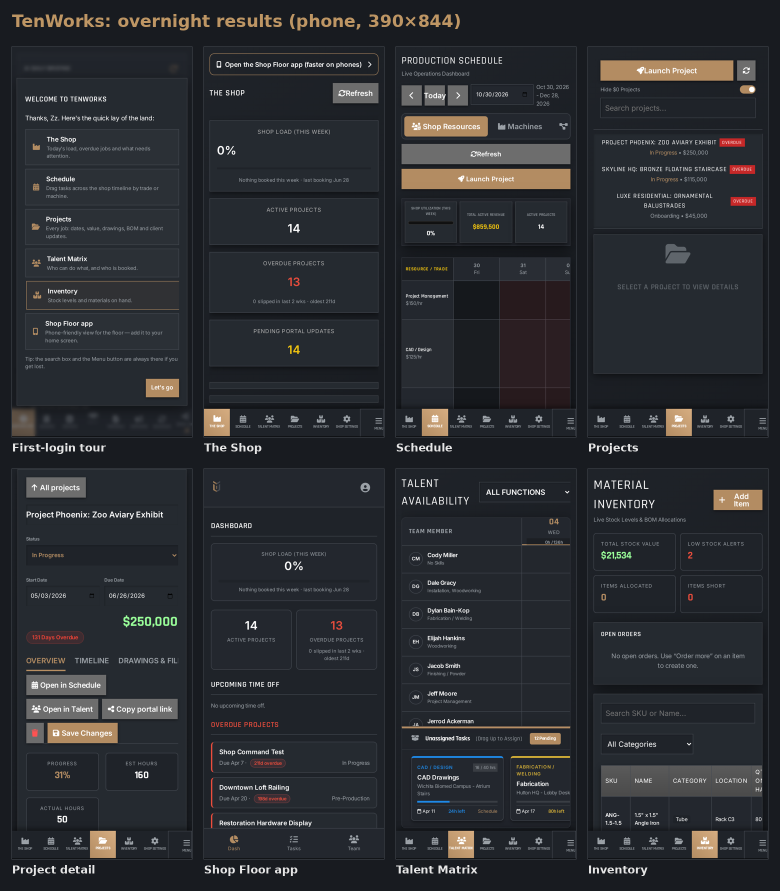

# TenWorks overnight report (Nov 4, 2026)

All work went to `main` on banneler/tenworks and is live at https://tenworks.vercel.app. I checked every change on production by behavior with a headless browser. Nothing needed reverting.

## Changes (commits)
| Commit | What |
|---|---|
| 5621747 | **Global search** now opens the project it finds. The link used `projectId`, but the page reads `project_id`. Results show project status, include inventory hits that link to `inventory.html?q=`, and are HTML-escaped with the input sanitized. Enter opens the first result and Esc closes. Added a shared `.kpi-grid`, which was undefined, so inventory KPIs had been unstyled. Tablet table scrolling, touch targets, and a print stylesheet. |
| 5c306c1 | Fixed a user-menu race: the menu now waits for `navReady`. This was the only console error on the site. |
| 2d3951c | **Data-safety bug:** the project status dropdown had no Onboarding, Fabrication, or Internal options, though those statuses are in the data. Opening such a project and pressing Save would blank its status. I added the options, plus a fallback for any unknown status. The selected list row's status text is readable again, and the inventory "Open orders" empty state is no longer clipped. |
| 20c94bc | `README.md` (architecture, env var names, local dev, deploy). `scripts/smoke.mjs` checks 22 pages, 4 assets, all 12 `/api/ai` actions, and `/api/admin`; the API checks confirm each is auth-gated and use no AI quota. Added the migration file. |
| 6326d23, 933cadd, 8745b62, 69caf2d | **Phone-first shop and PWA, per your update.** At ≤600px the sidebar becomes a fixed bottom tab bar within thumb reach, with all 7 tabs fitting on a 390px screen. The Menu popup opens above the bar. Controls are at least 44px, inputs use 16px text so iOS doesn't zoom, KPIs sit in 2 columns, and tables scroll sideways. `shop.html` shows an "Open the Shop Floor app" banner on phones only. PWA: added PNG icons at 192, 512, and maskable 512, plus a 180 apple-touch-icon, along with iOS standalone meta tags, `viewport-fit=cover`, and pinch-zoom turned back on. Service worker v2: it never intercepts POST, `/api`, or Supabase calls (v1 intercepted everything). It refreshes its cache, falls back to the app when offline, and deletes old caches. Added an offline bar to `mobile.html`. Also removed a `console.log` that printed the auth session. |

**Database (schema backed up first, to `backups/schema_backup_pre_overnight.json`):** migration `overnight_search_path_and_fk_indexes` pins `search_path` on 12 functions and adds 54 indexes on foreign keys. The advisors now show no `function_search_path_mutable` and no `unindexed_foreign_keys` warnings. The new indexes show up as "unused" until traffic hits them, which is expected.

## Verified on prod
- Smoke test: all checks pass.
- Search: Enter opens and selects the project, and `?q=ANG` filters inventory to 1 row.
- No console errors or 4xx/5xx on any page, for admin and for a regular user, at desktop, tablet, and phone sizes.
- Phone menu popup is visible at x=8, width 374.
- `mobile.html` service worker is active, and the page loads offline with the offline bar showing.
- A regular user still gets Access Denied on admin.
- Test users `zz-agent-test+admin` and `+user` and all their rows are deleted (0 remain).

## Screenshots (`/workspace/tenworks/screens/`)
- Before: `before-{admin,user}-<page>-{desktop,tablet}.png`, `before-admin-{mobile,shop,shop-dashboard,schedule}-phone.png`
- After: `after-{admin,user}-<page>-{desktop,tablet,phone}.png`, `after-admin-shop-phone-menu.png`, `after-admin-mobile-phone-offline.png`, `after-search-opens-project-tablet.png`, `after-print-inventory.png`
- Montages: `audit/montage-{desktop,tablet}.png`

## Open items, ranked
1. Shop Load / Capacity shows 0% everywhere while 14 projects are active. The capacity calculation or its data inputs need a look.
2. 13 of 14 active projects are overdue. That's probably stale due dates, but it makes the dashboard alarming.
3. Phone layouts for schedule (Gantt) and projects detail work but are dense. A dedicated phone view would come next.
4. `deals.js` ignores `?dealId`, so deep links from search don't open the deal.
5. Duplicate unique index on `ai_configs` (`ai_configs_function_id_key` and `unique_function_id`). It's safe to drop one, but I left it.

## Needs Bryan's decision
- **RLS performance:** 33 `auth_rls_initplan` and 138 `multiple_permissive_policies` advisor warnings. Fixing them means rewriting policies, which touches permissions, so I didn't.
- **Security-definer functions** that anon or authenticated users can execute, and the GraphQL table exposure warnings. Same reason.
- Leaked-password protection stays **off**, as instructed.
- Whether `shop.html` should redirect phones straight to `mobile.html` instead of showing the banner.

---

# Round 2 (Nov 4, 2026, ET)

## Commits (main, all verified live on tenworks.vercel.app)
| Commit | Change |
|---|---|
| 878ea95 | **Shop Load fix + overdue handling** (shop.html, mobile.html, TV dashboard) |
| a1ac5dc | `deals.html?dealId=N` scrolls to and pulses the deal (auto-enables "show closed lost"; toast if still hidden) |
| (migration) | Dropped duplicate `ai_configs.unique_function_id`; file `supabase/migrations/20261104230000_drop_duplicate_ai_configs_unique.sql` |
| 3f14ffe, 616d8c0, 36192b1, 45743d2, 3df042f, 93e85d2, e20c763, 9cfd7d3, 8274abb | Phone comfort: Schedule + Project detail (≤600px only; desktop untouched) |
| da76bed | Theme bug: `applyTheme()` wiped every `<body>` class (e.g. `schedule-page`), silently disabling page-scoped CSS. Now only swaps `theme-*`. |

## 1. Shop Load / Capacity at 0%
- **Real bug (TV dashboard, shop-dashboard.js):** each assignment counted the task's *entire* estimated_hours once per person-day against `talent × 10h`, ignoring `assignment.hours`. Now: explicit hours, else min(estimate, 8h)/day, against Σ(hours_per_week/5).
  - Verified against live data: week of Apr 21 → old **126%** (215h) vs correct **24%** (32h); May 5 → old 118% vs 12%.
- **shop.html / mobile 0% is truthful:** latest task_assignment is **Jun 28, 2026**; capacity is 17 active talent = 680h/wk. Card now says *"Nothing booked this week · last booking Jun 28"* (or "Xh booked of Yh capacity").

## 2. Overdue alarm (no due dates changed)
- Overdue card caption: *"N slipped in last 2 wks · oldest Nd"*; each list row has an "Nd overdue" badge; link fixed (`?id=` → `?project_id=`), names HTML-escaped.
- **Overdue projects for Bryan to clean up (13):**

| ID | Project | Status | Due | Days over |
|---|---|---|---|---|
| 10 | Shop Command Test | In Progress | Apr 7 | ~211 |
| 2 | Downtown Loft Railing | Pre-Production | Apr 20 | ~198 |
| 7 | Restoration Hardware Display | In Progress | Apr 23 | ~195 |
| 1 | Smith Modern Staircase | Fabrication | Apr 26 | ~192 |
| 6 | Skyline Loft Staircase | In Progress | Apr 28 | ~190 |
| 4 | Hutton HQ - Lobby Desk | Pre-Production | May 6 | ~182 |
| 5 | Wichita Biomed Campus - Atrium Stairs | Pre-Production | May 8 | ~180 |
| 8 | Centennial Park Sculpture | Pre-Production | May 31 | ~157 |
| 903 | Luxe Residential: Ornamental Balustrades | Onboarding | Jun 5 | ~152 |
| 15 | Demo – Phase 1 | In Progress | Jun 9 | ~148 |
| 902 | Skyline HQ: Bronze Floating Staircase | In Progress | Jun 10 | ~147 |
| 901 | Project Phoenix: Zoo Aviary Exhibit | In Progress | Jun 26 | ~131 |
| 16 | Demo – Phase 2 | Pre-Production | Aug 8 | ~88 |

  Likely test/demo rows to delete or complete: 10, 15, 16. Most have never had a client portal update.

## 3. Phone comfort (390×844)
- **Schedule:** stacked header, 44px controls, swipeable view toggle, full-width Refresh/Launch, 3-up compact KPIs, help banner hidden, Gantt resource column 260→112px (more timeline visible), no horizontal page overflow.
- **Projects:** list on top (scrollable, 45vh) instead of a squashed horizontal strip; tapping a project scrolls to the detail; "↑ All projects" button; header stacks (full-width status, dates side by side, value + overdue chip below); tabs swipe horizontally; BOM tables scroll.

## 4. Deal deep links — verified with a tagged test deal (pulse highlight found on phone + desktop). Note: real deals live in `deals_tw` (legacy `deals` table is empty).

## 5. ai_configs — backup at `backups/ai_configs_indexes_pre_drop.sql` (restore statement inside). Remaining: pkey, `ai_configs_function_id_key` UNIQUE(function_id), `unique_function_per_user`, FK. No code referenced the dropped name.

## 6. Polish pass
- Theme class-wipe bug fixed (above) — it was also the reason the schedule page's own scroll CSS never applied.
- Not done this round (judgment/time): broader first-login onboarding tour; left for a future round rather than shipping something half-baked.

## Left alone (Bryan's calls)
RLS policy rewrites; shop.html redirect; role permissions; leaked-password protection (off); edge functions.

## Hygiene
Temporary user `zz-agent-test+admin@tenworks-test.invalid` + its test account/deal created for verification and **deleted** (0 rows remain). No real data modified.

## Screenshots (screens/)
round2-shop-{phone,desktop}.png, round2-mobile-*.png, round2-schedule-*.png, round2-projects-list-*.png, round2-projects-detail-*.png, round2-deal-deeplink-*.png

## Round 3 (final)

**First-login experience** (`js/shared_constants.js`, `css/style.css`)
- The welcome modal asks for the user's name with inline validation (no `alert()`), then shows a one-time orientation tour: The Shop, Schedule, Projects, Talent Matrix, Inventory, and the Shop Floor app.
- The tour shows once per user. It is guarded by `user_metadata.tw_tour_done` (works across devices) and a localStorage key.
- No quota text appears. The welcome flow no longer selects `monthly_quota`.
- Bug fixed: the name save used `upsert`, which RLS rejects because users may UPDATE their own `user_quotas` row but not INSERT it. New users could never get past the name prompt. The save is now an UPDATE, with a fallback to INSERT. RLS is unchanged.
- Verified on prod (390×844) with a fresh test user:
  - The name prompt appears, then the tour.
  - Neither reappears on reload, on another page, or on a fresh desktop browser.
  - The name displays correctly.

**Smoke test:** `node scripts/smoke.mjs` against prod passes everything, both before and after the changes.

**Consistency sweep** (13 pages × phone and desktop on prod)
- All titles now follow the "TenWorks <Page>" pattern. Fixed the "Strategic - CRM", "TenWorks CRM" and "Ten Works ·" titles.
- Every page now has a favicon and an apple-touch-icon.
- Wording changes on Deals to fit a fab shop:
  - ARPU → Average Job Size
  - Commit/Best Case → Committed Work/Likely Work
  - Funnel → Pipeline
  - The Commit column is now "Committed"
- No user-visible "Constellation" or quota text remains. It survives only in code comments and CSS class names.
- No horizontal overflow and no JS errors on any page. The admin page shows "Access denied" to non-admins, as intended.
- Date formats and empty states were already consistent from round 2.
- Commits: 6201b3e, eea26cf, ecd590b. The CRLF line endings in index.html were preserved.

**Montage:** `/workspace/tenworks/screens/morning-montage.png` (on the agent box).

